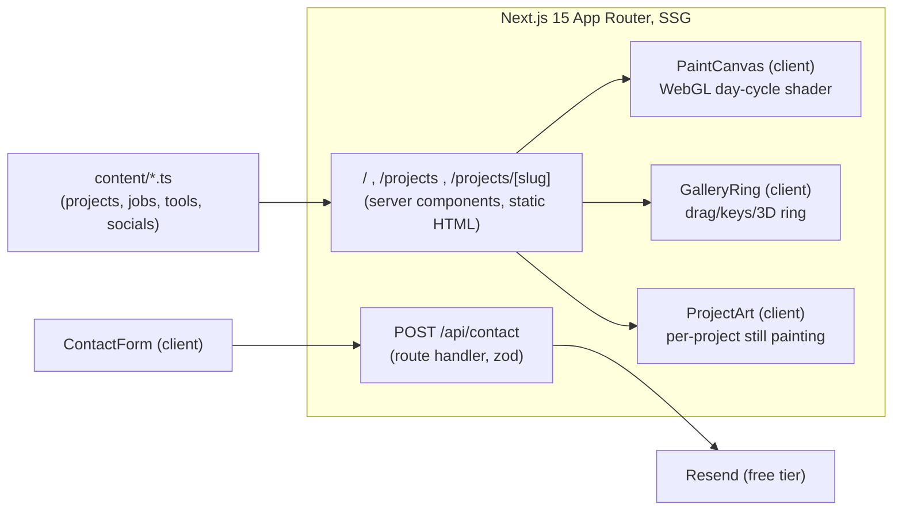

# Design 0001: Portfolio v3 ("masterpiece")

Status: accepted 2026-11-25. Decisions recorded at the end.

## Problem

The live portfolio (`react_stuff/3D_website_portfolio`, Vite + React + three.js on
Vercel at matheusdsantosr.com) has the right content but an outdated look and a
heavy bundle (two glTF models, react-slick, react-tilt, vertical-timeline).
`Matheus D. Santos Portfolio v2.html` is the new visual design: one WebGL
painted landscape that moves through a day as you scroll, glass panels, a 3D
ring gallery of procedurally painted project canvases, a project hub, and
per-project case study pages.

Goal: ship v2's design pixel-faithfully as a real, maintainable, SEO-friendly
codebase, carrying over every job, project and link from the old site.

Non-goals: redesign, a CMS, a blog, i18n.

## Architecture (recommended option, pending D1)

- **Content is data, not markup.** The `P` array and the jobs move into typed
  `content/` modules (`Project`, `Job`, `Tool` types). Pages render from them.
- **Server-rendered text, client-rendered motion.** All copy is static HTML
  (good for SEO and no-JS readers). The shader, ring, tilt and reveal effects are
  small client components that hydrate on top.
- **Hash routes become real routes.** v2's `#p-plai` / `#all-projects` views
  become `/projects/plai` and `/projects`, matching the old site's URLs, so
  existing links and the sitemap keep working.
- **Styling.** Port v2's CSS as-is into one global stylesheet with its `:root`
  tokens (see D2).

## Decisions for you

### D1. Framework

| | Next.js 15 SSG (rec.) | Vite + React SPA | Keep one HTML file |
|---|---|---|---|
| SEO per project page | static HTML per route | needs a prerender plugin | one page only |
| Contact backend | route handler in the same app | separate function | none |
| Matches your stated stack | yes | partly | no |
| Backend learning value | route handler, validation, env config | low | none |
| Cost on Vercel | free | free | free |
| Wrong choice when | you want a zero-build static file | you need no SEO | the site will grow |

### D2. Styling: port v2's CSS directly (rec.) or rewrite it in Tailwind

Your default stack is Tailwind, but "exact same design" pushes the other way.
v2 relies on long `clamp()` sizes, `backdrop-filter`, 3D transforms and CSS
variables set from JS (`--rx`, `--ry`, `--cw`). Translating all of that into
utility classes risks visual drift and gains nothing. Recommendation: keep the
CSS file and tokens as they are, and don't add Tailwind.

### D3. Contact form

| | Route handler + Resend (rec.) | EmailJS (old site) | mailto link |
|---|---|---|---|
| Secret exposure | API key server-only | public key in browser | none |
| You learn | input validation at the boundary, rate limiting, env secrets | nothing new | nothing |
| New deps | `resend`, `zod` | `@emailjs/browser` | none |
| Free tier | 3k emails/month | 200/month | n/a |

### D4. Project imagery

v2 uses only procedural paintings (no screenshots). The old site has real
screenshots (`project_1..7`). Options: (a) paintings only, as in v2; (b) the
painting in the ring, plus a real screenshot section on each case study page.
This is a visual decision, so it's yours.

## Content reconciliation (needs your answers)

1. **Plai stack conflict.** v2 says "Node, Express, Prisma, PostgreSQL, Llama
   3.1, YouTube Data API". The old site says "Next.js, React, TypeScript". Which
   is true?
2. **Tools list.** v2 drops Node.js, PostgreSQL, MySQL, Docker, Git, Figma and
   HTML/CSS from the old tech list. Add a "Backend and infra" row (Node.js /
   PostgreSQL / Docker / Git)? It helps the backend-role pitch.
3. **Reddit** (`u/matheusdsantosr`) is linked on the old site but not in v2. Keep it?
4. **Résumé route.** The old `notes.md` asks for a résumé page. Is it in scope for v3?
5. Six projects have no case study (only Plai has one). They render the dashed
   "Not written yet" cards. Should v3 hide those blocks or keep the placeholders?

## Testing

- Vitest: content integrity (unique slugs, every project has `ext` links and a
  palette, every route in the sitemap exists), contact payload validation.
- Playwright: home renders all sections, ring arrows/keys change the detail
  panel, each `/projects/[slug]` returns 200, reduced-motion disables
  animation, no horizontal scroll at 375px, contact form happy and error paths
  (mocked mail).
- Manual visual check side by side against `Matheus D. Santos Portfolio v2.html`.

## Delivery plan (one issue each, branch per issue)

1. chore: scaffold Next.js + TS + Vitest + Playwright, port global CSS.
2. feat: typed content modules plus content tests.
3. feat: PaintCanvas (shader, day cycle, cursor bead, idle-stop loop).
4. feat: home sections (hero, about, caps, tools, work).
5. feat: GalleryRing + ProjectArt.
6. feat: `/projects` hub and `/projects/[slug]` case studies.
7. feat: contact route handler + form.
8. chore: SEO (metadata, OG image, sitemap.xml, robots, JSON-LD).
9. chore: Vercel preview deploy. Switching the domain from the old site is a
   production change, so I'll ask you first.

## Migration and rollback

The old site stays live and untouched until v3 passes review on a Vercel
preview URL. The cutover is a domain reassignment in Vercel. Rollback means
pointing the domain back at the old project.

## Decisions (2026-11-25)

- D1: Next.js 15 App Router, static pages per route.
- D2: v2's CSS ported as one global stylesheet. No Tailwind.
- D3: `POST /api/contact` route handler, zod validation, Resend.
- D4: each project's painting is a brushstroke rendering of its real
  screenshot (same stroke shader as the background), not a generic landscape.
- Content: Plai keeps v2's stack (Node, Express, Prisma, PostgreSQL, Llama 3.1).
  Add a "Backend and infra" tools row. Keep the Reddit link. Résumé page is a
  separate issue pending confirmation. Every project gets a case study.
